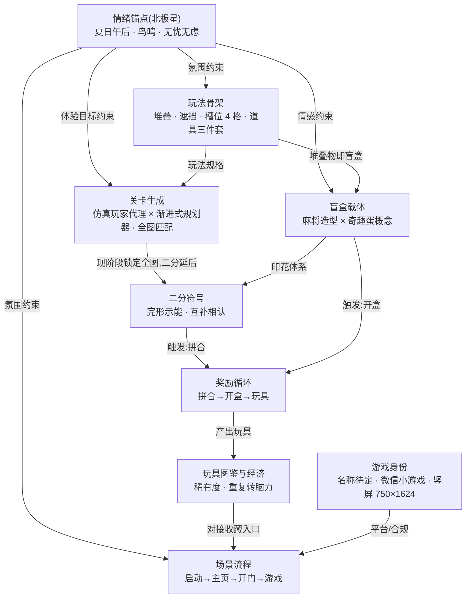

# 认知地图总览(map/)

> 收录**设计者确认保留**的概念、灵感与关系。未确认的想法只进 `history/`,确认后提取为节点;推翻的概念标记 ⛔ 不删除。

## 拓扑图



## 节点索引

| 节点 | 状态 | 一句话 |
|---|---|---|
| [identity](nodes/identity.md) | 🟡 名称未定 | 微信小游戏、竖屏 750×1624、Cocos 3.8.7 2D |
| [emotional-anchor](nodes/emotional-anchor.md) | ✅ | 设计北极星:夏日午后·鸟鸣·穿堂风·麻将当积木·无忧无虑 |
| [gameplay-core](nodes/gameplay-core.md) | ✅ **已实现并验证**(2026-11-19) | 多层堆叠、遮挡不可点、点击入槽 4 格、2 张互补消除、清空获胜、无计时 |
| [scene-flow](nodes/scene-flow.md) | 🟡 游戏场景已实现(测试形态);启动/主页/开门页未动工 | 启动→主页→开门加载→游戏;四页要点与周边系统 |
| [blind-box](nodes/blind-box.md) | ⛔ **已搁置**(2026-11-19) | 麻将造型×盲盒——实现改采真实麻将牌面体系;概念留档,玩具收集仍可衔接图鉴 |
| [split-symbol](nodes/split-symbol.md) | ✅ 数据层就绪(L/R)/ ⏳ 视觉未启用(当前为全图对) | 配对=互补相认:完整元素的二分,完形示能 |
| [reward-loop](nodes/reward-loop.md) | 🟡 v1 已实现(吸引+爆闪);开盒/玩具弹出未做 | 配对→拼合→发亮→开盒→玩具飞入图鉴 |
| [toy-economy](nodes/toy-economy.md) | 🟡 框架确认,细节未定 | 玩具宇宙、稀有度三档、重复转脑力、对接收藏图鉴 |
| [level-generation](nodes/level-generation.md) | 🟡 求解器①~④已实现并迭代(③决策扫描梯 v1,2026-11-23;匹配消耗改为消除模拟 + 拾取差分择优,2026-11-24);③决策逐梯改造中(第一阶梯已完成);⑤对账与规划器未动工 | 仿真玩家代理×渐进式规划器闭环;现阶段全图匹配(FULL),元素重复度为主轴 |

## 关系表(边)

| 从 | 关系 | 到 | 说明 |
|---|---|---|---|
| emotional-anchor | 情感约束 | blind-box | 材质温度、拆礼物的童年快乐 |
| emotional-anchor | 氛围约束 | gameplay-core | 慢节奏、无苛刻计时、失败温柔 |
| emotional-anchor | 氛围约束 | scene-flow | 夏日光线、微风动效、环境音优先于音乐 |
| gameplay-core | 承载体 | blind-box | 盲盒即堆叠物,继承麻将造型(M1/M5 整齐清晰) |
| blind-box | 分类手段 | split-symbol | 印花体系按二分符号设计(M2 的升级) |
| split-symbol | 触发 | reward-loop | 两半拼合是奖励链第一拍 |
| blind-box | 触发 | reward-loop | 开盒视效是奖励链核心拍 |
| reward-loop | 产出 | toy-economy | 开盒得玩具入图鉴 |
| toy-economy | 对接 | scene-flow | 主页"收藏奖励"入口即图鉴入口 |
| identity | 平台约束 | scene-flow | 微信胶囊避让、健康忠告合规 |
| emotional-anchor | 体验目标约束 | level-generation | 难度 = 体验轨迹(张力曲线受控、失败温柔),非最大化难度 |
| gameplay-core | 玩法规格 | level-generation | 堆叠/遮挡/槽 4/配对规则即生成器目标约束 |
| level-generation | 阶段决策 | split-symbol | 现阶段全图匹配(FULL);L/R 数据层就绪,延后启用 |
| background(麻将优势 M1~M7) | 论证支撑 | blind-box / split-symbol | 见 [background/mahjong-advantages.md](../background/mahjong-advantages.md) |
| background(可解性/玩家模型研究) | 论证支撑 | level-generation | 见 [background/solvability-research.md](../background/solvability-research.md)、[player-model-research.md](../background/player-model-research.md) |

## 节点文件格式

```markdown
# 节点:<名称>
> 状态:✅ 已确认 | 🟡 方向确认,参数未定 | ⛔ 已推翻(被 X 取代)
> 确认:YYYY-MM-DD(来源:用户/会话)
## 内容(已确认)
## 未决参数(⏳)
## 关系(登记于 MAP.md 的边)
## 背景依据(→ background/ 链接)
```
